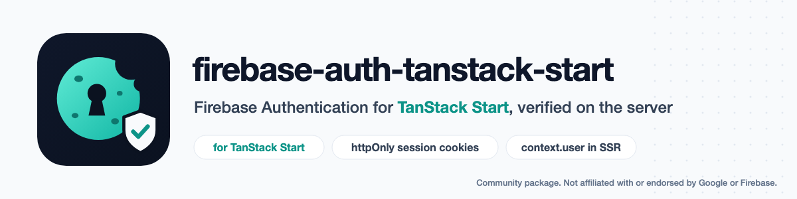

<p align="center">
  <picture>
    <source media="(prefers-color-scheme: dark)" srcset="art/banner-dark.png">
    
  </picture>
</p>

# firebase-auth-tanstack-start: Firebase Authentication for TanStack Start with SSR session cookies

**Firebase Authentication for [TanStack Start](https://tanstack.com/start)**: the browser signs in with the Firebase JS SDK as usual, and the server gets an `HttpOnly` Firebase **session cookie**, so the signed-in user is known during server rendering, in server functions, in server routes and in `beforeLoad` route guards. Tokens are verified with Web Crypto against Google's public keys through [`jose`](https://github.com/panva/jose) (no `firebase-admin` needed), or through `firebase-admin` if you already use it.

> Community package by Amjad Iqbal. **Not affiliated with, endorsed by or supported by Google or Firebase.**

[](https://www.npmjs.com/package/@amjadiqbal/firebase-auth-tanstack-start)
[](package.json)
[](LICENSE.md)

```ts
// A server function: the request middleware already verified the session cookie.
export const getProfile = createServerFn().handler(({ context }) => {
  const user = auth.requireUser(context) // throws 'auth/unauthenticated' (401) when signed out
  return { uid: user.uid, role: user.claims.role } // custom claims, typed
})
```

## What you get

| Piece | Import from | What it does |
|---|---|---|
| `createFirebaseAuth()` | `/server` | Verifies the session cookie (or an `Authorization: Bearer` ID token) and gives you a typed `FirebaseUser` with custom claims. |
| `auth.middleware()` | `/server` | Body for a Start request middleware: `context.user` in every page render, server function and server route; deletes dead cookies. |
| `auth.loginHandler()`, `auth.logoutHandler()` | `/server` | POST handlers: Firebase ID token → session cookie; logout deletes it (and can revoke the user's tokens). Same-origin check built in. |
| `auth.requireUser()` | `/server` | Returns the user, or throws `auth/unauthenticated` (401) / `auth/forbidden` (403). |
| `restBackend()` | `/server` | The default verifier: Web Crypto and `fetch`, no `firebase-admin`. |
| `firebaseAdminBackend()` | `/admin` | Uses your `firebase-admin` `Auth` instead. |
| `requireAuth()` | `.` | A `beforeLoad` guard: sends signed-out visitors to your login page with `?redirect=`, optional claim check. |
| `firebaseAuthErrorAdapter` | `.` | A Start serialization adapter, so errors from server functions reach the browser with their `code`. |
| `useFirebaseUser()` | `/react` | Keeps the server cookie in step with the browser's Firebase sign-in (`onIdTokenChanged`). |
| App Check | `/server` | Optional `X-Firebase-AppCheck` verification on login, or anywhere with `auth.verifyAppCheck()`. |

## Install

```bash
npm i @amjadiqbal/firebase-auth-tanstack-start firebase
```

`firebase` is for the browser and the React hook. Add `firebase-admin` only for the `/admin` backend. Peer dependencies: `@tanstack/react-start` ^1.168.0, `@tanstack/react-router` ^1.170.0, and `react` 18 or later for `/react`. Node 22.12 or later (TanStack Start's own minimum).

## Setup

These are the files of the app this package was tested in (see [What's tested](#whats-tested)), trimmed.

### 1. `src/firebase-auth.server.ts`

Keep it in a `*.server.ts` file: Start's import protection keeps those out of the browser bundle.

```ts
import { createFirebaseAuth } from '@amjadiqbal/firebase-auth-tanstack-start/server'

export type AppClaims = { role?: 'admin' | 'editor' }

export const auth = createFirebaseAuth<AppClaims>({
  projectId: process.env.FIREBASE_PROJECT_ID!,
  // Needed to make session cookies (login) and to revoke; verifying needs only the project ID.
  serviceAccount: {
    clientEmail: process.env.FIREBASE_CLIENT_EMAIL!,
    privateKey: process.env.FIREBASE_PRIVATE_KEY!, // escaped "\n" sequences are turned into newlines
  },
  // Development only: accept the Auth Emulator's unsigned tokens.
  emulatorHost: process.env.FIREBASE_AUTH_EMULATOR_HOST,
})
```

`AppClaims` is the type you declare; nothing checks claim values at runtime.

<details>
<summary>With <code>firebase-admin</code> instead</summary>

```ts
import { firebaseAdminBackend } from '@amjadiqbal/firebase-auth-tanstack-start/admin'
import { createFirebaseAuth } from '@amjadiqbal/firebase-auth-tanstack-start/server'
import { getApps, initializeApp } from 'firebase-admin/app'
import { getAuth } from 'firebase-admin/auth'

export const auth = createFirebaseAuth<AppClaims>({
  backend: firebaseAdminBackend(getAuth(getApps()[0] ?? initializeApp())),
})
```

`firebase-admin` reads `FIREBASE_AUTH_EMULATOR_HOST` from the environment itself.
</details>

### 2. `src/middleware.ts` and `src/start.ts`: `context.user` everywhere

```ts
// src/middleware.ts
import { createMiddleware } from '@tanstack/react-start'
import { auth } from './firebase-auth.server'

export const firebaseAuthMiddleware = createMiddleware().server(async ({ request, next }) =>
  next({ context: await auth.middleware({ request }) }),
)
```

```ts
// src/start.ts
import { firebaseAuthErrorAdapter } from '@amjadiqbal/firebase-auth-tanstack-start'
import { createCsrfMiddleware, createStart } from '@tanstack/react-start'
import { firebaseAuthMiddleware } from './middleware'

// Listing your own request middleware drops Start's default CSRF check for server functions: add it back.
const csrfMiddleware = createCsrfMiddleware({ filter: (ctx) => ctx.handlerType === 'serverFn' })

export const startInstance = createStart(() => ({
  serializationAdapters: [firebaseAuthErrorAdapter],
  requestMiddleware: [csrfMiddleware, firebaseAuthMiddleware],
}))
```

You write the middleware's one-line wrapper yourself because Start's compiler strips server code only from `createMiddleware().server()` calls in your app's own files. `context.user` is then typed in every server function and server route.

### 3. Login and logout routes

```ts
// src/routes/api/auth/login.ts
import { createFileRoute } from '@tanstack/react-router'
import { auth } from '../../../firebase-auth.server'

export const Route = createFileRoute('/api/auth/login')({
  server: { handlers: { POST: ({ request }) => auth.loginHandler(request) } },
})

// src/routes/api/auth/logout.ts: the same, with '/api/auth/logout' and auth.logoutHandler(request)
```

### 4. `src/routes/__root.tsx`: the user on the router context, and the hook

```tsx
import type { FirebaseUser } from '@amjadiqbal/firebase-auth-tanstack-start'
import { useFirebaseUser } from '@amjadiqbal/firebase-auth-tanstack-start/react'
import { createRootRouteWithContext, Outlet, useRouter } from '@tanstack/react-router'
import { createServerFn } from '@tanstack/react-start'
import type { AppClaims } from '../firebase-auth.server'
import { firebaseAuth } from '../lib/firebase' // getAuth(initializeApp({ ... })) from the Firebase JS SDK

const getSessionUser = createServerFn().handler(({ context }) => context.user)

export const Route = createRootRouteWithContext<{ user: FirebaseUser<AppClaims> | null }>()({
  beforeLoad: async () => ({ user: await getSessionUser() }),
  component: Root, // plus your shellComponent
})

function Root() {
  const { user } = Route.useRouteContext()
  const router = useRouter()
  const firebase = useFirebaseUser(firebaseAuth, { serverUser: user, onSessionChange: () => router.invalidate() })
  return (
    <>
      {user ? <button onClick={() => firebase.signOut()}>Sign out {user.email}</button> : null}
      <Outlet />
    </>
  )
}
```

Create the router with `context: { user: null }`. The login page only calls `signInWithEmailAndPassword()` (or any Firebase sign-in): the hook posts the new ID token to `/api/auth/login`, and `router.invalidate()` reloads `context.user`.

### 5. Guard routes

```ts
// src/routes/_authed.tsx: every route under _authed/ needs a signed-in user
import { requireAuth } from '@amjadiqbal/firebase-auth-tanstack-start'
import { createFileRoute } from '@tanstack/react-router'

export const Route = createFileRoute('/_authed')({ beforeLoad: requireAuth({ redirectTo: '/login' }) })
```

Signed-out visitors go to `/login?redirect=<the page they wanted>` (`searchParam: 'next'` renames the parameter, `false` drops it). The guard returns `{ user }`, so child routes see a non-null `context.user`. With a claim check:

```ts
beforeLoad: requireAuth<{ claims: AppClaims }>({
  redirectTo: '/login',
  authorize: (user) => user.claims.role === 'admin',
  forbiddenTo: '/forbidden', // without it the guard throws FirebaseAuthError 'auth/forbidden'
}),
```

A guard also runs in the browser, so it protects pages, not data. Protect data in the server function with `auth.requireUser(context, authorize?)`.

## Security defaults

- **The cookie** is `__session` (the only cookie [Firebase Hosting](https://firebase.google.com/docs/hosting/manage-cache#using_cookies) passes to your backend), always `HttpOnly`, `Secure`, `SameSite=Lax`, `Path=/`, `Max-Age` 5 days (Firebase allows 5 minutes to 14 days). Login and logout responses have `Cache-Control: no-store`. Change these with the `cookie` option; `sameSite: 'none'` requires `secure`. Chromium accepted the `Secure` cookie on `http://localhost` in the test app; if your browser drops it in plain-HTTP development, use `cookie: { secure: process.env.NODE_ENV === 'production' }`.
- **CSRF on login and logout**: both handlers accept only POST from the request's own origin: the `Origin` header must match, or, when there is no `Origin`, `Sec-Fetch-Site` must be `same-origin`; with neither, the request is refused. Behind a proxy that changes the scheme or host your server sees, list your public origin in `allowedOrigins`. The list **replaces** the default, so include every origin that should be able to log in, including the request's own if it still applies. The login body must be `application/json`, which a plain HTML form cannot send.
- **CSRF on server functions** is Start's `createCsrfMiddleware`, set up in step 2. In the test app, a cross-site POST to a server function with a valid session cookie got 403 with that line; without it, the request reached the server function.
- **The emulator**: with `emulatorHost` set, the default backend accepts **unsigned** tokens, because the Auth Emulator issues unsigned tokens. The package never reads the emulator host from the environment on its own; set the option only in development.
- **Revocation** is off by default, as in `firebase-admin`: a session cookie stays valid until it expires. `checkRevoked: true` asks Firebase on every request whether the user was disabled or their tokens revoked (one Identity Toolkit call per request). With the default backend that needs `serviceAccount` (it does not read Application Default Credentials; without it you get `auth/credential-required`); the `firebase-admin` backend uses whatever credentials your Admin app has. `revokeOnLogout: true` revokes the user's refresh tokens at logout, which signs them out on **every** device. With both on, a copied cookie stops working at logout. If revoking fails, the logout route still deletes the cookie and answers with the error (for example 500 `auth/credential-required`).
- **Clock skew**: `clockToleranceSeconds` (default 0, like `firebase-admin`) allows that many seconds of difference when checking `exp`, `iat` and `auth_time`. It applies to the default backend only; with `backend: firebaseAdminBackend(...)` it is ignored, and so are `serviceAccount` and `emulatorHost`.
- **Google's public keys** (default backend): the certificates for ID tokens and for session cookies are each downloaded on first use and kept for the response's `Cache-Control: max-age` (when a response has none, they are downloaded again on every check). A token whose `kid` is not in the kept set triggers one early download, at most once a minute per certificate URL, because Google rotates its keys; if the `kid` is still unknown the token is refused as invalid.
- **Recent sign-in**: Firebase's guide only makes a session from an ID token whose sign-in is under 5 minutes old. Here that check is opt-in (`maxAuthAgeSeconds: 300`), because the hook also uses the login route to renew an expired cookie while the browser is still signed in to Firebase. With the check on, renewing needs a fresh sign-in.

## How the hook keeps browser and server in step

`useFirebaseUser(auth, { serverUser })` treats the browser's Firebase sign-in as the source of truth:

| Browser (Firebase) | Server (`serverUser`) | The hook |
|---|---|---|
| signed in as A | none, or B | posts A's ID token to the login route, then calls `onSessionChange()` |
| signed in as A with other custom claims than `serverUser.claims` | A | the same (for example after `setCustomUserClaims()` and `getIdToken(true)`) |
| signed out | A | posts to the logout route, then calls `onSessionChange()` |
| same user and claims | | nothing |

It checks when Firebase reports a token change, and when `serverUser` changes (for example when the cookie expired and `router.invalidate()` reloaded `context.user` as `null`). It returns `{ user, status: 'loading' | 'signed-in' | 'signed-out', syncing, error, signOut }`. `signOut()` deletes the server session first, then signs out of Firebase. A failed call sets `error` to a `SessionSyncError` with the route's `code` and `status`; `signOut()` signs the browser out of Firebase even when its logout call failed (and the hook then tries the logout route again). Without `serverUser`, it calls the server on every page load.

Because the browser decides, an origin where Firebase is signed out deletes a session cookie it shares with another origin (for example two apps on `localhost` with different ports).

## Bearer tokens

With `bearer: true` (the default), a request with `Authorization: Bearer <Firebase ID token>` is verified as an ID token instead of reading the cookie, for mobile apps or scripts calling your server routes. A bearer token that fails gives `user: null` and does not fall back to the cookie. `bearer: false` accepts only the cookie.

## App Check

```ts
createFirebaseAuth({ /* ... */ appCheck: { projectNumber: '123456789012' } })
```

The login handler then requires a valid `X-Firebase-AppCheck` header (`requireOnLogin: false` makes it optional there), and `auth.verifyAppCheck(request)` checks it anywhere else, returning `{ appId, claims }`. The checks are the ones Firebase documents for JWT libraries: `RS256` and `typ: JWT`, signed by a key from App Check's JWKS (kept six hours, as `firebase-admin` does), issuer `https://firebaseappcheck.googleapis.com/<projectNumber>`, audience containing `projects/<projectNumber>`, not expired. In the hook, pass `getAppCheckToken: async () => (await getToken(appCheck)).token`.

Limits, so you can decide whether this is enough:

- **No replay protection.** Tokens are verified, not consumed: a token can be used again until it expires. `firebase-admin`'s `verifyToken(token, { consume: true })` (limited-use tokens) is not wired in; call it yourself in a server route if you need it.
- **No clock tolerance** for App Check tokens, whatever `clockToleranceSeconds` says.
- **Always the package's own verifier**, also when you use the `firebase-admin` backend for sessions.
- Keys are kept six hours; an unknown `kid` triggers one early download, at most once a minute.
- On login, App Check is checked first, before the body is read, so a missing token answers `app-check/missing-token` even when the body is also wrong.

## Errors

Every error is a `FirebaseAuthError` with a `code` and the HTTP `status` the handlers answer with. The login and logout handlers answer `{ "error": { "code", "message" } }`.

| Code | Status | When |
|---|---|---|
| `auth/invalid-id-token` | 401 | not a JWT, bad signature, unknown `kid`, not `RS256`, wrong `aud` or `iss`, empty `sub` or longer than 128 characters, `iat` or `auth_time` in the future; or Firebase refused it when making the cookie |
| `auth/id-token-expired` | 401 | `exp` has passed |
| `auth/id-token-revoked` | 401 | with `checkRevoked`: signed in before the user's tokens were revoked |
| `auth/invalid-session-cookie`, `auth/session-cookie-expired`, `auth/session-cookie-revoked` | 401 | the same for the cookie (issuer `https://session.firebase.google.com/<projectId>`) |
| `auth/user-disabled`, `auth/user-not-found` | 401 | with `checkRevoked` (always on the emulator) |
| `auth/recent-sign-in-required` | 401 | login with `maxAuthAgeSeconds` and an older sign-in |
| `auth/invalid-request` | 400 | login body not `application/json` or without an `idToken` string; also no `projectId` and no `backend`, or `verifyAppCheck()` without the `appCheck` option |
| `auth/csrf-rejected` | 403 | login or logout from another origin, or with neither `Origin` nor `Sec-Fetch-Site: same-origin` |
| `auth/method-not-allowed` | 405 | a handler called with anything but POST (answers with `Allow: POST`) |
| `auth/unauthenticated`, `auth/forbidden` | 401, 403 | `requireUser()` (which also sets that response status), and `requireAuth()` without `forbiddenTo` |
| `auth/credential-required` | 500 | the default backend without `serviceAccount` asked to make a cookie, revoke, or check revocation |
| `auth/internal-error` | 500 | Google's keys or APIs unreachable, or any unexpected error |
| `app-check/missing-token`, `app-check/invalid-token` | 401 | App Check |

The handlers only answer for the methods you mount them on: a GET to a route that has only a `POST` handler is answered by Start, not by the package.

`auth.authenticate(request)` never throws for a bad credential. It returns `{ user, source: 'session-cookie' | 'bearer' | null, error, clearCookie }`; `clearCookie` is `true` only when the cookie can never become valid again (invalid, expired, revoked, user disabled or deleted), not after a network error. `auth.middleware()` deletes such cookies.

With `firebaseAuthErrorAdapter` registered (step 2), an error thrown in a server function arrives in the browser as a `FirebaseAuthError` with `code` and `status`. Without it, the browser gets a plain `Error` with only the message.

## Edge runtimes

The default backend's own code uses only Web Crypto, `fetch` and `jose`. The `/server` entry also imports `setCookie` and `setResponseStatus` from `@tanstack/react-start/server`, and Start's server runtime uses `node:async_hooks` (AsyncLocalStorage), so your edge platform needs that, as it does for Start itself. **It has been run on Node only.** Cloudflare Workers, Vercel Edge and Netlify Edge have not been tried. The `/admin` backend needs `firebase-admin`, which does not run on edge runtimes ([firebase-admin-node#2069](https://github.com/firebase/firebase-admin-node/issues/2069)).

## What's tested

- **82 unit tests** (vitest, run on Node 24.15 and 22.23): the default backend with RSA keys and X.509 certificates generated on each run and Google's endpoints mocked (signatures, every claim check, expiry and clock tolerance, key caching by `Cache-Control: max-age`, download on every check without it, one early re-download for a rotated `kid`, the service-account token exchange and its signature, making and revoking sessions, revoked, disabled and deleted users, Identity Toolkit errors, emulator mode); the login and logout handlers (cookie attributes, CSRF, content type, method, App Check, `maxAuthAgeSeconds`, revoke on logout); `authenticate`, `middleware` and `requireUser`; App Check (including key rotation); the `firebase-admin` adapter's argument passing and error mapping with a stubbed SDK; the route guard; and the React hook with the Firebase SDK mocked.
- **10 integration tests against the Firebase Auth Emulator** (`npm run test:emulator`, firebase-tools 15.34.1), the same five for each backend (`restBackend` and `firebaseAdminBackend` with firebase-admin 14.5.0): verify an ID token, make a session cookie and verify it, custom claims carried into the cookie, a revoked cookie and ID token refused after `revokeRefreshTokens`, disabled and deleted users refused, garbage refused.
- **A real TanStack Start app against the Firebase Auth Emulator** (firebase-tools 15.34.1) with Start 1.169.4, Router 1.170.46, React 19.3.1, Vite 8.3.5, firebase 13.1.0 and firebase-admin 14.5.0 on Node 24.15, installing the packed tarball. It ran in the dev server and as a production build served with `vite preview`.
  - Both backends passed the same 18 HTTP checks: the cookie's attributes; refusal of cross-origin logins and logouts, form bodies and bad tokens; the user in the server-rendered HTML; a guarded page redirecting when signed out; cookie and bearer authentication in a server route; deletion of a bad cookie; a custom claim on the server user and the claim-guarded route; and, with `revokeOnLogout`, the old cookie refused as `auth/session-cookie-revoked` after logout.
  - In the browser: sign-up and sign-in returning to the page that asked; the user rendered on the server after a reload; the cookie unreadable from JavaScript; server functions from the browser, including `auth/unauthenticated` (401) arriving as a `FirebaseAuthError` once signed out and `auth/forbidden` (403); sign-out; a non-admin sent to `/forbidden`; and a claim set in the emulator reaching the server after `getIdToken(true)` with one login call.
  - The production client bundle contained none of the package's server code.
  - The lowest supported peers, Start 1.168.0 and Router 1.170.0, passed the same 18 HTTP checks in a production build, `tsc` on the app, and a browser sign-in.
- **Not tested**: a live Firebase project (Google-signed tokens, the service-account token exchange with Google, real session cookies: these paths are covered only by the unit tests with generated keys), edge runtimes, the test app on Node versions other than 24 (the unit tests also ran on 22), browsers other than Chromium, and App Check outside the unit tests (the emulator has no App Check). Please open an issue if anything behaves differently on a live project.

## Coming from `next-firebase-auth-edge`

That Next.js package keeps its own signed cookies holding the ID and refresh tokens. This one uses Firebase's own session cookie: one `HttpOnly` cookie signed by Firebase, verified the way `firebase-admin` verifies it, with no signing keys of your own. Its middleware becomes the request middleware in step 2, `getTokens()` becomes `context.user` (or `auth.getUser(request)`), and its login and logout API routes become step 3.

## Support

- 🐛 **Bug or feature request**: [open an issue](https://github.com/amjadiqbal/firebase-auth-tanstack-start/issues)
- 🔒 **Security issue**: please report privately via GitHub's security tab

## Need this built into your app, or something custom?

I build and fix TanStack Start, Router and Query apps, including authentication, Firebase and migrations.
[Get in touch](https://amjad.com.pk/contact?utm_source=github&utm_medium=readme&utm_campaign=firebase-auth-tanstack-start).

## More packages

Part of a family of open-source packages. See [all of them](https://github.com/amjadiqbal?tab=repositories).

| | |
|---|---|
| [start-seo-kit](https://github.com/amjadiqbal/start-seo-kit) | SEO for TanStack Start: meta tags, sitemaps, JSON-LD |
| [shopify-app-tanstack-start](https://github.com/amjadiqbal/shopify-app-tanstack-start) | Embedded Shopify apps on TanStack Start |
| [tanstack-table-url-state](https://github.com/amjadiqbal/tanstack-table-url-state) | URL state and CSV/XLSX export for TanStack Table |
| [query-key-kit](https://github.com/amjadiqbal/query-key-kit) | Typed query keys and invalidation for TanStack Query v5 |

## License

MIT. See [LICENSE.md](LICENSE.md). Firebase is a trademark of Google LLC.
